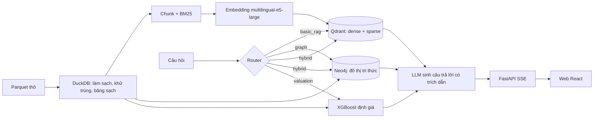

# Vietnam Real Estates — từ RAG đến GraphRAG

Trợ lý hỏi đáp thị trường bất động sản Việt Nam trên toàn bộ dataset tin đăng
[tinixai/vietnam-real-estates](https://huggingface.co/datasets/tinixai/vietnam-real-estates).
Dự án so sánh bốn cách trả lời trên cùng dữ liệu, cùng bộ câu hỏi và cùng mô hình ngôn ngữ:

| Hệ thống | Cách tìm bằng chứng | Mạnh ở |
| --- | --- | --- |
| **LLM only** | Không truy xuất; cùng mô hình, không có ngữ cảnh | Baseline: đo truy xuất thêm được gì |
| **Basic RAG** | LLM trích bộ lọc → dense (`multilingual-e5-large`) + BM25 trên Qdrant, gộp RRF, lọc trước theo payload → LLM trả lời có `[Tin#id]` | Tìm theo mô tả tự do: "gần trường", "có thang máy" |
| **Graph** | Text2Cypher: LLM sinh Cypher chỉ đọc trên đồ thị tri thức Neo4j → LLM diễn giải kết quả | Câu tổng hợp, đếm, xếp hạng, đa chặng |
| **Hybrid** | Router chọn Basic RAG, Graph, định giá hoặc gộp ngữ cảnh; đồ thị lỗi hoặc rỗng thì lui về Basic RAG | Câu vừa có điều kiện cấu trúc vừa có mô tả |

RAG/GraphRAG là chủ đề chính. Module định giá (XGBoost dự đoán giá/m²) là phần phụ, dùng làm tool `valuate()` cho router.

## Mục lục

- [Kiến trúc](#kiến-trúc)
- [Dữ liệu và giấy phép](#dữ-liệu-và-giấy-phép)
- [Yêu cầu môi trường](#yêu-cầu-môi-trường)
- [Pipeline](#pipeline)
- [Đánh giá](#đánh-giá)
- [API, web và Docker](#api-web-và-docker)
- [Notebook](#notebook)
- [Kết quả](#kết-quả)
- [Kiểm thử và CI](#kiểm-thử-và-ci)
- [Cấu trúc thư mục](#cấu-trúc-thư-mục)
- [Hạn chế](#hạn-chế)

## Kiến trúc



- **Bảng sạch** (`data/clean/listings.parquet`): DuckDB đọc các shard thô, chuẩn hoá địa danh, sửa giá nhập theo nghìn đồng, ẩn số điện thoại
  và email, khử trùng chính xác + trùng tiền tố, gom tin gần trùng bằng SimHash (giữ lại, đánh dấu `dup_cluster_id`).
- **Chỉ mục vector**: collection Qdrant `vre_chunks_e5_large` (alias `vre_chunks`), mỗi điểm có vector dense và vector sparse BM25
  (tách từ `pyvi`), payload index cho lọc trước. Lý do chọn `multilingual-e5-large` ở notebook `01_rag_indexing` (đọc `results/embedding_benchmark.json`).
- **Đồ thị tri thức**: `Listing` gắn với `Ward`/`District`/`Province`, `Street`, `Project`, `PropertyType`, `Month`, `Amenity`; `MarketStat`
  là thống kê giá tính sẵn theo vùng × loại × tháng; `Cluster` là cộng đồng Leiden của các phường. Text2Cypher chạy trong giao dịch chỉ đọc,
  có chặn regex, `LIMIT` và timeout.
- **LLM**: Groq (API tương thích OpenAI), structured output cho bộ lọc, Cypher, router và chấm điểm; cache đĩa theo nội dung prompt.
  Mô hình chấm (`JUDGE_MODEL`) phải khác mô hình sinh (`LLM_MODEL`).

## Dữ liệu và giấy phép

- Dataset: [tinixai/vietnam-real-estates](https://huggingface.co/datasets/tinixai/vietnam-real-estates), giấy phép
  [CC BY-NC 4.0](https://creativecommons.org/licenses/by-nc/4.0/) (chỉ dùng phi thương mại, ghi công tác giả dataset).
  Kết quả và mô hình sinh từ dữ liệu này thừa hưởng điều kiện phi thương mại.
- Ranh giới hành chính cho bản đồ: [geoBoundaries](https://www.geoboundaries.org/) gbOpen VNM — ADM1 (tỉnh) giấy phép
  Public Domain (2008), ADM2 (huyện) nguồn OCHA ROAP giấy phép
  [CC BY 3.0 IGO](https://creativecommons.org/licenses/by/3.0/igo/) (2020); địa giới trước sắp xếp năm `2025`. Sinh lại bằng
  `python scripts/build_geo.py`; nguồn được ghi công ở chân trang web.
- Giá trong dữ liệu là giá chào bán do người đăng tự nhập, không phải giá giao dịch.

## Yêu cầu môi trường

- Windows, mọi thứ trên ổ **D** (dữ liệu, cache Hugging Face/pip/torch, TMP, npm, Playwright). Trước mọi lệnh, nạp biến môi trường:

  ```powershell
  . D:\Vietnam-Real-Estates\scripts\vre_env.ps1   # đặt VRE_DATA_ROOT, HF_HOME, TMP... về D:\Vietnam-Real-Estates\.cache và tạo $VRE_PY
  ```

- Python `3.13` trong `.venv`; GPU CUDA cho bước embedding và biến thể định giá `full`.
- Docker Desktop: Qdrant và Neo4j chạy bằng `docker-compose.yaml` (project `vre`). Dữ liệu dịch vụ nằm trong named volume
  (đĩa WSL của Docker Desktop đặt trên ổ D); log Neo4j bind mount ra `docker-data/`.

```powershell
& $VRE_PY -m pip install -r requirements/ml.txt        # torch CUDA: cài wheel từ index PyTorch trước (xem đầu file)
& $VRE_PY -m pip install -r requirements/dev.txt       # pytest, ruff, mypy, nbclient, ipykernel
Copy-Item .env.example .env                            # điền GROQ_API_KEY, NEO4J_PASSWORD
docker compose -f D:\Vietnam-Real-Estates\docker-compose.yaml up -d --wait qdrant neo4j
```

Test không đọc `.env` (`VRE_LOAD_DOTENV=0` trong `tests/conftest.py`), nên chạy được trên máy không có khoá.

## Pipeline

Mọi bước là một lệnh của `scripts/vre_pipeline.py`, idempotent (artifact đã có và fingerprint khớp thì in "đã xong" rồi thoát), và
kiểm điều kiện tiên quyết trước khi chạy (thiếu shard, thiếu model trong cache, dịch vụ chưa sẵn sàng, ổ D đầy… thì dừng ngay).

| Lệnh | Làm gì | Ghi ra |
| --- | --- | --- |
| `& $VRE_PY scripts/vre_pipeline.py ingest` | Nạp, làm sạch, khử trùng | `data/clean/`, `results/ingest_report.json`, `results/embedding_benchmark.json` |
| `& $VRE_PY scripts/vre_pipeline.py eda` | Thống kê mô tả + hình | `results/eda_summary.json`, `results/eda/*.png` |
| `& $VRE_PY scripts/vre_pipeline.py graph` | Nạp đồ thị Neo4j bằng `neo4j-admin import` | `results/graph_report.json` |
| `& $VRE_PY scripts/vre_pipeline.py price --variant tabular` | Định giá trên đặc trưng cấu trúc (CPU) | `models/valuation/`, `results/valuation_metrics.json` |
| `& $VRE_PY scripts/vre_pipeline.py night --resume` | Chunk → BM25 → embed → upload Qdrant → HNSW → kiểm tra → PCA | `index/`, `results/night_report.json` |
| `& $VRE_PY scripts/vre_pipeline.py price --variant full` | Định giá thêm vector mô tả nén PCA (GPU) | `results/valuation_metrics.json` |
| `& $VRE_PY scripts/vre_pipeline.py all --resume` | Toàn bộ chuỗi trên theo thứ tự | |
| `& $VRE_PY scripts/vre_pipeline.py status` | Tiến độ lượt chạy dài | |

**Lượt chạy dài** (`night`): embed và upload toàn bộ chunk mất nhiều giờ (thời gian thật của lần chạy gần nhất ở
`results/night_report.json` → `wall_hours`, hiển thị trong notebook `01_rag_indexing`). Bị ngắt (mất điện, tắt máy, lỗi bộ nhớ) thì chạy lại
**đúng lệnh cũ**: pipeline đọc trạng thái từng phần và tiếp tục từ phần chưa xong. Chạy thử nhỏ trước bằng `--dry-run`.

## Đánh giá

- `benchmark/questions.jsonl`: bộ câu hỏi chia theo nhóm `lookup`, `constraint`, `aggregate`, `multihop`, `temporal`, `comparison`,
  `project_street`, `valuation`, `unanswerable`; mỗi câu có tuyến đúng cho router. Đáp án chuẩn tính bằng SQL DuckDB trên toàn bộ bảng
  sạch (lưu kèm câu SQL), không gõ tay, ghi vào `results/benchmark_gt.json`; file câu hỏi không bao giờ bị code ghi đè.
- `& $VRE_PY scripts/vre_pipeline.py eval` chạy bốn hệ thống trên mọi câu, chấm bằng LLM giám khảo khác mô hình sinh, tính recall/MRR/nDCG,
  các chỉ số kiểu RAGAS, chi phí và độ trễ, khoảng tin cậy bootstrap ghép cặp theo câu hỏi, rồi phân tích nguyên nhân lỗi
  → `results/eval_summary.json`, `results/error_analysis.json`.
- `& $VRE_PY scripts/vre_pipeline.py ablation` so sánh cấu hình truy hồi (dense/BM25/hybrid, lọc trước, rerank, kích thước chunk) trên
  subcorpus chứa mọi tin đáp án → `results/ablation.json`. So sánh giữa các model embedding chỉ lấy từ `results/embedding_benchmark.json`.
- `& $VRE_PY scripts/vre_pipeline.py report examples` → `results/examples.json`; `& $VRE_PY scripts/vre_pipeline.py report readme` điền
  khối [Kết quả](#kết-quả) bên dưới.

## API, web và Docker

API FastAPI (`api/`), hợp đồng ở `plans/261015-vre-full-retrain/api-contract.md`, OpenAPI ở `api/openapi.json`:

```powershell
& $VRE_PY -m uvicorn api.main:app --host 127.0.0.1 --port 8000 --timeout-keep-alive 5
$env:VRE_FAKE_BACKENDS = '1'   # chạy API với dữ liệu giả (không cần Qdrant/Neo4j/LLM) để phát triển web và chạy e2e
```

- `POST /api/chat` và `POST /api/compare` trả luồng SSE (token, nguồn, Cypher, route, usage). Có giới hạn kích thước body, độ dài câu hỏi,
  số câu đồng thời và tần suất theo IP; rate limit chạy trước kiểm khoá.
- Đặt `VRE_API_TOKEN` thì mọi `/api/*` (trừ `/api/health`) cần header `X-API-Key`; không nhận khoá qua URL. Không có token thì API chỉ
  bind loopback.

Web React + Vite + TypeScript (`web/`): Chat, So sánh bốn hệ, Bản đồ, Định giá, Dashboard thị trường, Benchmark.

```powershell
npm --prefix web ci
npm --prefix web run build
npm --prefix web run e2e        # Playwright + axe, cần API chạy với VRE_FAKE_BACKENDS=1
```

Docker (profile `app`): `docker compose --profile app up -d --build --wait` dựng `api` và `web`; mở `http://127.0.0.1:8080`.
Container API mount read-only cache Hugging Face, `results/`, `models/`, `data/clean/` và `index/` từ máy.

## Notebook

Sáu notebook trong `notebooks/`, sinh từ một nguồn duy nhất `notebooks/build_notebooks.py` (không sửa tay file `.ipynb`).
Mỗi bước có mã `Px-yy`: một ô markdown `### Px-yy · <kết luận>` và một ô code mở đầu `# Px-yy · ẨN|CACHE|LIVE`. Mọi con số
trong heading được điền từ `results/*.json` hoặc cache cell, không gõ tay; thiếu dữ liệu thì ô ghi rõ "chưa có".

| Notebook | Nội dung |
| --- | --- |
| `00_setup.ipynb` | Dùng chung, các notebook khác gọi bằng `%run ./00_setup.ipynb`: đường dẫn, seed, cấu hình `vre.config`, hàm đọc kết quả/cache, chặn LLM thật |
| `01_rag_indexing.ipynb` | EDA, làm sạch và khử trùng, chunk theo token, embedding `multilingual-e5-large`, dense + BM25 trong Qdrant |
| `02_retrieval_generation.ipynb` | Trích bộ lọc, dense/BM25/hybrid (RRF), lọc trước trên payload, rerank, sinh câu trả lời có trích dẫn `[Tin#ID]` |
| `03_knowledge_graph.ipynb` | Schema Neo4j, entity resolution, nạp hàng loạt, Cypher tra cứu/tổng hợp/đa chặng, cộng đồng Leiden |
| `04_graphrag_eval.ipynb` | Text2Cypher và router, Recall@k/MRR/nDCG, chỉ số kiểu RAGAS, so bốn hệ thống có CI bootstrap |
| `05_valuation.ipynb` | XGBoost `tabular` và `full` (thêm PCA embedding) so với baseline trung vị phường; tool `valuate()` |

Ba kiểu cell:

- **ẨN**: thiết lập, không ra kết quả (đường dẫn, cấu hình, hàm dùng chung, kiểm tra dịch vụ nào có trên máy).
- **CACHE**: đọc `results/*.json` hoặc cache cell `results/nb_cache/<id>.json`; chưa có cache và đủ điều kiện thì tính một lần từ
  dữ liệu rồi ghi.
- **LIVE**: demo nhẹ chạy thật khi dịch vụ/model có mặt (Qdrant, Neo4j, cache Hugging Face, dữ liệu sạch) và ghi lại cache cell;
  thiếu điều kiện hoặc lỗi thì đọc cache cell, nên notebook luôn chạy được.

Cache cell nằm ở `results/nb_cache/` dưới gốc code và được commit; `results/*.json` đọc từ `VRE_DATA_ROOT` (mặc định gốc repo).

| Biến | Tác dụng |
| --- | --- |
| `VRE_NB_OFFLINE=1` | Mọi cell LIVE/CACHE chỉ đọc cache, không cần Docker, GPU hay khoá LLM (cách CI chạy) |
| `VRE_NB_REBUILD=1` | Bỏ qua cache của cell CACHE và tính lại (khi đủ điều kiện) |
| `VRE_NB_STRICT=1` | Cell LIVE lỗi thì dừng với lỗi, không lặng lẽ lùi về cache (test notebook bật cùng `VRE_NB_OFFLINE`) |

Notebook **không bao giờ gọi LLM thật**: mọi lời gọi chạy trong `llm_cache_only()`, chỉ đọc cache đĩa LLM (`results/cache/llm`);
câu chưa có trong cache thì cell báo và bỏ qua phần đó. Không tốn token, không cần khoá API.

Sinh lại nguồn, chạy và lưu output (từ gốc repo, sau `. scriptsre_env.ps1`):

```powershell
& $VRE_PY notebooks/build_notebooks.py          # cả 6 notebook
& $VRE_PY notebooks/build_notebooks.py 02 04    # chỉ notebook có tiền tố 02, 04
```

## Kết quả

Khối dưới đây do `scripts/vre_pipeline.py report readme` sinh từ `results/*.json`; không sửa tay.

<!-- results:start -->
### Benchmark (36/100 câu, sinh `gemini-flash-lite-latest`, chấm theo luật, không giám khảo LLM, `79fe53b`)

| Nhóm | llm_only | basic_rag | graph | hybrid |
|---|---|---|---|---|
| lookup | 0.0% [0–0%] | 100.0% [100–100%] | 100.0% [100–100%] | 100.0% [100–100%] |
| constraint | 0.0% [0–0%] | 0.0% [0–0%] | 100.0% [100–100%] | 0.0% [0–0%] |
| aggregate | 25.0% [0–75%] | 0.0% [0–0%] | 100.0% [100–100%] | 100.0% [100–100%] |
| multihop | 0.0% [0–0%] | 0.0% [0–0%] | 75.0% [25–100%] | 75.0% [25–100%] |
| temporal | 0.0% [0–0%] | 25.0% [0–75%] | 100.0% [100–100%] | 100.0% [100–100%] |
| comparison | 50.0% [0–100%] | 0.0% [0–0%] | 100.0% [100–100%] | 75.0% [25–100%] |
| project_street | 0.0% [0–0%] | 0.0% [0–0%] | 100.0% [100–100%] | 100.0% [100–100%] |
| valuation | 0.0% [0–0%] | 0.0% [0–0%] | 0.0% [0–0%] | 0.0% [0–0%] |
| unanswerable | 25.0% [0–75%] | 75.0% [25–100%] | 75.0% [25–100%] | 75.0% [25–100%] |
| **Tổng** | 11.1% [3–22%] | 22.2% [8–36%] | 83.3% [69–94%] | 69.4% [53–83%] |

Độ chính xác (2/2 điểm), CI 95% bootstrap 10.000 mẫu theo câu hỏi, seed 42.

| So sánh | Phạm vi | Chênh lệch | CI 95% | p | n |
|---|---|---|---|---|---|
| hybrid − basic_rag | overall | +47.2 điểm % | [+30.6, +63.9] | 0.000 | 36 |
| hybrid − basic_rag | aggregate | +100.0 điểm % | [+100.0, +100.0] | 0.000 | 4 |
| hybrid − basic_rag | multihop | +75.0 điểm % | [+25.0, +100.0] | 0.003 | 4 |
| basic_rag − llm_only | overall | +11.1 điểm % | [-8.3, +30.6] | 0.154 | 36 |
| basic_rag − llm_only | aggregate | -25.0 điểm % | [-75.0, +0.0] | 0.320 | 4 |
| basic_rag − llm_only | multihop | +0.0 điểm % | [+0.0, +0.0] | 1.000 | 4 |
| hybrid − graph | overall | -13.9 điểm % | [-25.0, -2.8] | 0.004 | 36 |
| hybrid − graph | aggregate | +0.0 điểm % | [+0.0, +0.0] | 1.000 | 4 |
| hybrid − graph | multihop | +0.0 điểm % | [+0.0, +0.0] | 1.000 | 4 |

| Hệ thống | Độ trễ p50 (ms) | p95 (ms) | Token vào/ra TB | USD/câu | Trích dẫn sai | Fallback |
|---|---|---|---|---|---|---|
| llm_only | 4029 | 11841 | 82/158 | 0.00000 | 0.0% | 0.0% |
| basic_rag | 10468 | 37000 | 1942/260 | 0.00000 | 0.0% | 0.0% |
| graph | 8855 | 23016 | 3843/308 | 0.00000 | 0.0% | 0.0% |
| hybrid | 8989 | 21686 | 4063/398 | 0.00000 | 0.0% | 5.6% |

Router (hybrid): 91.7% trên 36 câu; 93.8% khi bỏ nhóm unanswerable.

Luật chấm (không LLM):

- ids: capped cluster Recall@5 over the system's sources; 2 if >= 0.8, 1 if > 0, else 0
- value (numeric GT): any number in the answer within value_tolerance (default 5%) of gt_value => 2; within max(20%, 2x tolerance) => 1; else 0 (lenient any-number match)
- value (numeric GT < 0, e.g. '% lower'): an answer number matches by absolute value only if the answer also says thấp hơn/giảm/rẻ hơn/kém
- value (text GT not in the question): diacritic-folded, lower-cased answer contains gt_value => 2, else 0
- value (text GT that the question itself names, i.e. comparisons): gt_value must appear within 60 characters before the first 'cao/đắt/lớn/nhiều hơn' in the answer => 2, else 0
- valuation: first amount or range ('a đến b tỷ' => midpoint) with unit 'tỷ'/'triệu' (converted to tỷ) within value_tolerance => 2, within 2x => 1
- value (month GT 'YYYY-MM'): any month in the answer written as 'MM/YYYY', 'M/YYYY', 'tháng M/YYYY', 'tháng M năm YYYY' or 'YYYY-MM' equal to gt_value => 2, else 0
- value (comparison category): the winner rule applies even when the question abbreviates the options (e.g. 'q3')
- non-refusal questions (value, valuation): an answer containing a refusal phrase => 0, checked before any match
- refusal: answer contains a refusal phrase (no data / insufficient information / out of range) => 2, else 0
- empty answer => 0; faithfulness = null (needs an LLM)

> ragas: answer_relevancy và context_precision bỏ để tiết kiệm lời gọi LLM (chỉ đo faithfulness)
> retrieval: nguồn = top_k=5 tin mà hệ thống đưa vào ngữ cảnh; recall_at_10 vì thế ≤ recall_at_5 khi có hơn 5 cụm đúng (truy xuất thuần ở ablation.json)
> benchmark đầy đủ có 100 câu; bản tóm tắt này chấm 36 câu (benchmark_subset)
> pairwise chỉ dùng câu cả hai hệ thống đều có điểm; overall_common chỉ dùng câu mọi hệ thống đều có điểm; mọi CI có n kèm theo

### Định giá (tập kiểm tra)

| Biến thể | MAE (tr/m²) | MAPE | R² |
|---|---|---|---|
| tabular | 32.62 | 24.0% | 0.73 |
| full | 24.05 | 19.1% | 0.84 |
| baseline_ward_median | 50.61 | 46.0% | 0.48 |

### Ablation truy xuất (e5-large)

| Run | Recall@5 | MRR | nDCG@10 | n |
|---|---|---|---|---|
| full_dense | 0.29 | 0.28 | 0.28 | 27 |
| full_dense_prefilter | 0.50 | 0.60 | 0.51 | 27 |
| full_bm25 | 0.27 | 0.30 | 0.26 | 27 |
| full_bm25_prefilter | 0.58 | 0.68 | 0.60 | 27 |
| full_hybrid | 0.36 | 0.30 | 0.30 | 27 |
| full_hybrid_prefilter | 0.53 | 0.65 | 0.55 | 27 |
<!-- results:end -->

## Kiểm thử và CI

```powershell
& $VRE_PY -m pytest -q -m "not integration and not gpu and not notebooks"   # unit, không mạng/GPU/Docker
& $VRE_PY -m pytest -q -m notebooks tests/test_notebooks.py                   # chạy cả sáu notebook bằng nbclient
& $VRE_PY -m pytest -q -m integration                                         # cần Qdrant + Neo4j đang chạy
& $VRE_PY -m ruff check src tests scripts
```

CI (`.github/workflows/ci.yml`) chạy trên mỗi push và pull request, không có `.env`: `lint` (ruff + mypy), `unit` (pytest + coverage),
`notebooks` (chạy notebook trên `results/` đã commit), `web` (lint, typecheck, vitest, build, Playwright với API giả).

## Cấu trúc thư mục

```text
src/vre/            Package chính: config, checks, data (ingest, eda), index (chunk, BM25, Qdrant, đồ thị), pipeline (lượt chạy dài),
                    rag, graph (Text2Cypher), hybrid (router), llm, eval, valuation, qa (facade cho API)
scripts/            vre_pipeline.py (CLI), vre_env.ps1 (biến môi trường ổ D), night.ps1, build_geo.py
benchmark/          questions.jsonl — bộ câu hỏi đánh giá
api/                FastAPI + SSE, chế độ dữ liệu giả, OpenAPI
web/                React + Vite + TypeScript + Tailwind
notebooks/          Năm notebook trình bày + build_notebooks.py
results/            JSON kết quả nhỏ (được commit); cache, eval thô và parquet bị bỏ qua
graph/              Cypher sau import (constraint, index)
tests/              unit, integration, gpu, api, notebook
plans/              Kế hoạch và hợp đồng dữ liệu/API
data/ index/ models/ docker-data/   Sinh ra khi chạy pipeline, không đưa vào Git
```

## Hạn chế

- Giá chào bán do người dùng tự nhập: có nhiễu, có tin đăng lại có sửa chữ mà SimHash không gom được; không phản ánh giá giao dịch.
- Dữ liệu tập trung mạnh ở Hà Nội và Hồ Chí Minh (tỷ trọng in ở notebook `01_rag_indexing`); kết luận cho tỉnh ít tin kém tin cậy hơn.
- Địa danh theo địa giới trước sắp xếp năm `2025`; bản đồ và đồ thị chưa phản ánh đơn vị hành chính mới.
- Số tin thuê quá ít để huấn luyện mô hình định giá thuê (lý do ghi ở `results/valuation_metrics.json` → `rent_model`).
- Bộ lọc, Cypher, router và câu trả lời phụ thuộc LLM; cần khoá Groq khi chạy lần đầu, lần sau đọc cache. LLM có thể chép sai id trong
  `[Tin#id]` (đo bằng `bad_citation_rate`).
- Benchmark là bộ câu hỏi có hạn: so sánh tương đối giữa bốn hệ thống, kèm khoảng tin cậy; không có ý nghĩa thống kê thì ghi đúng như vậy.
